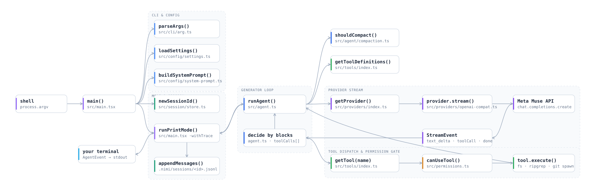

<p align="center">
  <picture>
    <source media="(prefers-color-scheme: dark)" srcset="docs/assets/nimi-logo-dark.png">
    
  </picture>
</p>

<p align="center">
  <strong>A lightweight, open-source terminal coding-agent harness. Every step, inspectable.</strong>
</p>

<p align="center">
  <a href="https://www.npmjs.com/package/nimi-code"></a>
  <a href="LICENSE"></a>
</p>

# nimi

Nimi points a language model at your codebase and gives it controlled access to your files, shell, and git — read, search, write, edit, run commands — until the job is done. Read-only tools run freely; anything that mutates pauses at an explicit permission gate. Every run is recorded as a JSONL trace you can replay, and a browser playground visualizes a sample run step by step.

What Nimi is **not**: not a model, not a subscription, not a hosted platform. You bring your own provider key, run everything on your own machine, and can fork the whole thing (ISC licensed).

## Quickstart

Requires **Node 22+** and one provider key.

```bash
npm install -g nimi-code
export META_API_KEY=...   # or ANTHROPIC_API_KEY, GROQ_API_KEY, DEEPSEEK_API_KEY, OPENAI_API_KEY
cd /path/to/your/project
nimi "list the typescript files under src"
```

That's it — Nimi opens an interactive session in your terminal. Give it a task in plain language.

## Usage

| Mode | Command | Behavior |
|---|---|---|
| Interactive (default) | `nimi "task"` | Full terminal UI with streaming output |
| Classic REPL | `nimi --classic "task"` | Plain readline loop, compact result previews |
| One-shot | `nimi --print "task"` | Runs once, streams to stdout, exits (scriptable) |
| Pipe | `echo ... \| nimi -p` | Prompt from stdin, no TTY needed |

### Flags

```
nimi [message]            interactive (default)
nimi --classic [message]  plain REPL
nimi --print [message]    one-shot, streams to stdout
echo ... | nimi -p        prompt from pipe

-p, --prompt <text>       prompt to send
-z, --provider <id>       anthropic, anthropic-openai, groq, meta (default), deepseek, openai
    --model <id>          override the provider's default model
    --session <id>        resume a session (--list-sessions to list)
    --context-limit <n>   override context window
    --trace <path>        write a JSONL showcase trace (print mode)
    --classic --print --yolo
-v, --version  -h, --help
```

### Slash commands (interactive mode)

`/model` `/tools` `/sessions` `/session` `/compact` `/context` `/clear` `/help` `/quit` — bare `clear`, `quit`, `exit`, and `q` work too.

Examples:

```bash
nimi -p "explain this codebase" --provider deepseek
nimi "find all TODOs and write them to NOTES.md"
nimi --session abc123 "continue where we left off"
nimi --list-sessions
```

## Tools & permissions

Read-only tools run without asking. Mutating tools pause at a gate: `[y]es` / `[a]lways` / `[n]o` — `always` is remembered per tool for the session. Piped/non-TTY runs auto-allow (pass `--yolo` explicitly to skip prompts in a terminal).

| Runs freely (read-only) | Asks first (mutating) |
|---|---|
| `read`, `ls`, `find`, `grep` | `write`, `edit`, `bash` |
| `git_status`, `git_log`, `git_diff` | `git_add`, `git_commit`, `git_branch`, `git_checkout`, `git_reset` |

Denying a tool doesn't crash the run — the model gets an error result (`User denied <name>…`) and decides what to do next.

## Providers

Nimi is provider-agnostic over OpenAI-compatible APIs. The default provider is `meta`.

| Provider (`-z`) | Key | Default model |
|---|---|---|
| `anthropic` | `ANTHROPIC_API_KEY` | `claude-sonnet-5` |
| `anthropic-openai` | `ANTHROPIC_API_KEY` | `claude-sonnet-5` (OpenAI-compatible endpoint) |
| `groq` | `GROQ_API_KEY` | `qwen/qwen3.8-27b` |
| `meta` (default) | `META_API_KEY` | `muse-spark-1.3-contributor` |
| `deepseek` | `DEEPSEEK_API_KEY` | `deepseek-flash` |
| `openai` | `OPENAI_API_KEY` | `gpt-4o-mini` |

Override the model per run with `--model <id>`, per environment with `NIMI_MODEL`, or switch mid-session with `/model`.

## Config, sessions, context

Settings cascade (each level wins over the previous):

`~/.nimi/settings.json` → `.nimi/settings.json` (project) → `NIMI_PROVIDER` / `NIMI_MODEL` → CLI flags

Sessions persist per project in `.nimi/sessions/` — resume with `--session <id>`, list with `--list-sessions`. On startup Nimi also loads project context from `AGENTS.md`, `CLAUDE.md`, `.context`, and `.nimi/context.md` when present.

## Traces

Every run can be recorded as JSONL — one line per event and message snapshot — and resumed or inspected later:

```bash
nimi --print -p "find all TODOs" --trace demo/samples/showcase.jsonl
```

The trace is the same artifact the web playground replays below: events fold into turns, tool calls, permission decisions, and terminal output.

## Web playground (local)

`demo/` is a static Vite + React app that replays the bundled sample trace — a trace viewer and explainer, not a live agent. No API key needed.

```bash
cd demo
npm install
npm run dev     # → http://localhost:5173
```

- **Home** explains the harness; **Playground** (`#/playground`) is the workbench: Dataflow/Streaming graph, step inspector (Overview, Events, Context, Source, plus raw payload/stdout), timeline scrubber, keyboard shortcuts (`space` play, `←/→` step), and URL-addressable playback state.
- The **sample selector** replays four lenses over the same trace (full run, denied-permission branch, Classic view, TUI view). **Allow/Deny only switches the replay branch** — it controls no live machine.
- Production build: `npm run build` → `demo/dist/` (gitignored), deployable to any static host.

## Architecture

```
prompt → parseArgs → settings → system prompt + tool catalog → runAgent()
  → provider.stream() → assistant reply → permission gate → tool.execute()
  → tool result → … → session file (.nimi/sessions/<id>.jsonl) + optional --trace JSONL
```

<picture>
  <source media="(prefers-color-scheme: dark)" srcset="docs/assets/architecture-dark.svg">
  
</picture>

Generated from the same graph data as the playground (`demo/src/data/architecture.js`). Regenerate with `node scripts/export-architecture-svg.mjs`.

### Repo layout

| Path | Contents |
|---|---|
| `bin/` | `nimi` executable entry |
| `src/main.tsx` | CLI entry, mode router, trace wiring |
| `src/agent.ts` | Agent loop (`runAgent`) |
| `src/cli/` | Flag parser |
| `src/config/` | Settings cascade, system prompt |
| `src/providers/` | Anthropic + OpenAI-compatible providers, default models |
| `src/tools/` | Read/write/shell/git tool implementations |
| `src/permissions.ts` | `y/a/n` permission gate |
| `src/session/` | JSONL session store |
| `src/trace/` | JSONL trace recorder |
| `src/modes/` `src/tui/` | Classic REPL and Ink terminal UI |
| `demo/` | Static web playground (sample trace replay) |
| `test/` | Offline tool tests |
| `docs/assets/` | README logo and architecture diagram |

## Development

```bash
npm install
cp .env.example .env   # add one provider key
npm run build          # build with tsup
node bin/nimi.js "hello"

npm run check     # biome lint + tsc typecheck
npm test          # offline tool tests (vitest)
npm run test:tools
```

## Contributing

Issues and pull requests are welcome. Run `npm run check` and `npm test` before submitting. See `AGENTS.md` for repo conventions (Astryx workflow for `demo/`, tokens, required checks).

## License

[ISC](LICENSE) — do what you want, keep the copyright notice.
