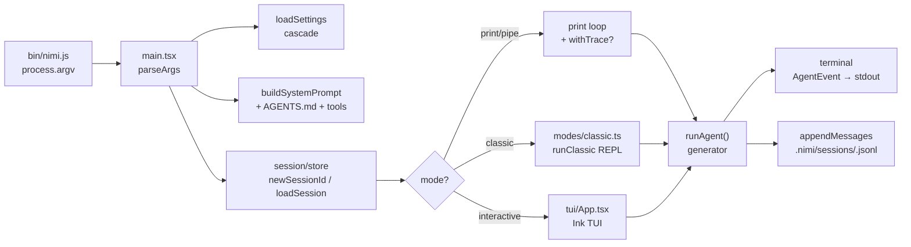
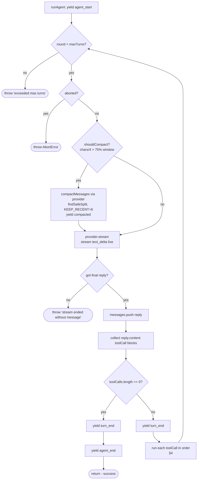
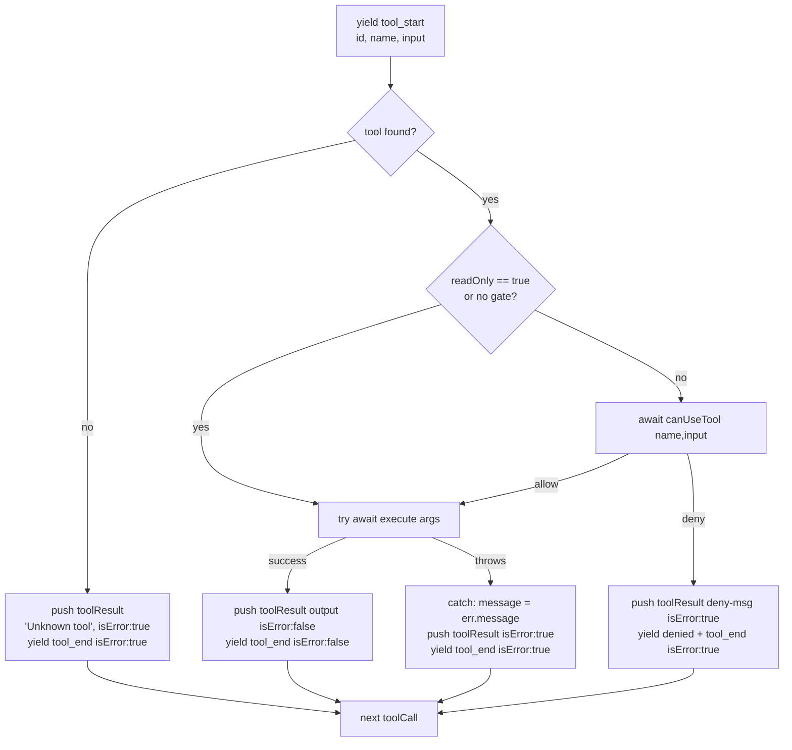
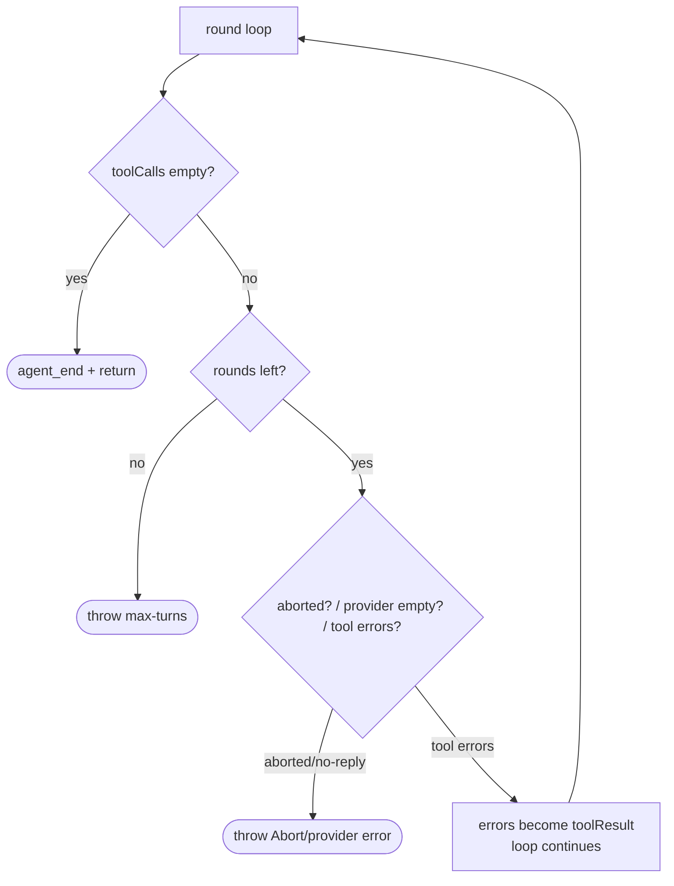
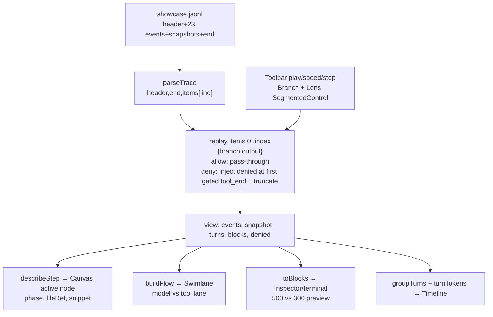
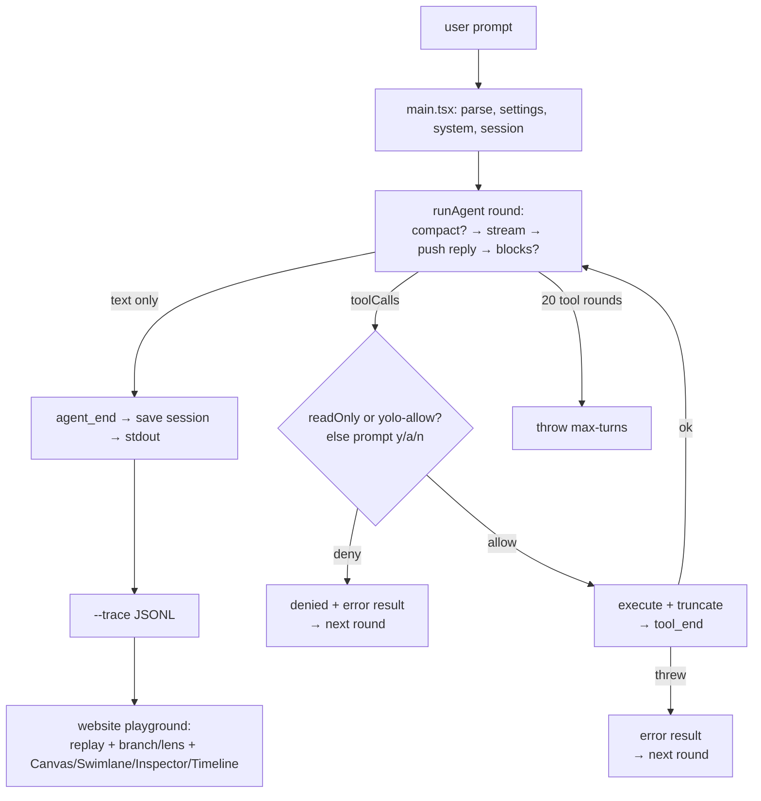

# Nimicode — Complete Explanation (agent loop, stopping, tool failures, playground)

> Source-grounded to this repo. File refs are `path:line`.

## 1. What Nimicode is

- Single-machine terminal coding agent: LLM + controlled access to files/shell/git.
- You bring provider key (`META_API_KEY`, `ANTHROPIC_API_KEY`, ...). No hosted platform.
- 15 tools in `src/tools/index.ts:14`: `read, write, edit, bash, ls, find, grep, git_status, git_log, git_diff, git_add, git_commit, git_branch, git_checkout, git_reset`.
- `readOnly: true` tools (`read, ls, find, grep, git_status/log/diff`) run freely; everything else hits permission gate.
- Every run is an async generator event stream (`src/agent.ts:12-20`), rendered by 3 modes, optionally tee'd to JSONL trace.

## 2. Startup → agent (the outer frame)

```
bin/nimi.js → src/main.tsx:22 parseArgs → loadSettings → buildSystemPrompt → session → mode → runAgent()
```

| Step | File | What happens |
|---|---|---|
| `parseArgs(process.argv.slice(2))` | `src/main.tsx:22`, `src/cli/arg.ts:21` | Parses `-p/--prompt, -z/--provider, --model, --session, --trace, --classic/--print/--yolo` |
| `loadSettings()` | `src/config/settings.ts:21` | Merge `~/.nimi/settings.json` + `.nimi/settings.json` + `NIMI_PROVIDER/MODEL` + CLI flags |
| `getProvider(name)` | `src/providers/index.ts:55` | Resolves OpenAI-compatible provider; `MissingApiKeyError` → TUI `/login` wizard or hard error in `--print`/pipe |
| `buildSystemPrompt()` | `src/config/system-prompt.ts:11` | Base prompt + 15 tool specs + `AGENTS.md/CLAUDE.md/.context/.nimi/context.md` |
| session open | `src/session/store.ts:21`, `src/main.tsx:114-128,183-197` | Resume `--session <id>` loads `.nimi/sessions/<id>.jsonl`, else `newSessionId()` + `session_info` line |
| mode dispatch | `src/main.tsx:97,199,228` | `--print`/non-TTY = one-shot stdout; `--classic` = `runClassic()` readline; default = Ink TUI `tui/App.tsx` |
| `runAgent({provider,model,system,messages,tools,canUseTool})` | `src/agent.ts:36` | The generator loop below |



## 3. The agent loop (the core)

File: `src/agent.ts:36-191`. `maxTurns = options.maxTurns ?? 20`.

Per round:

1. `yield {type:"agent_start"}` once.
2. `signal.throwIfAborted()` — Ctrl-C / caller abort kills round immediately.
3. Compaction guard (`src/agent/compaction.ts:28`): if `estimateTokens(chars/4) > 75%` window → `compactMessages()` → `yield compacted`.
4. `for await (provider.stream({messages,model,tools,system}))` — re-yield each `text_delta` live; buffer final `reply: AssistantMessage`.
5. `messages.push(reply)` **before** tools (keeps `user → assistant → toolResult` order providers require).
6. Collect `toolCalls: ToolCallBlock[]` by scanning `reply.content` for `type==="toolCall"`.
7. **Decide by blocks, not `stopReason`** (`src/agent.ts:94`): providers sometimes say `end_turn` even with tools, so blocks are truth.
8. If `toolCalls.length===0` → `yield turn_end` → `yield agent_end` → `return`.
9. Else `yield turn_end`, then run each call sequentially (see §4), then `continue` → next round with results in history.



Events yielded: `agent_start, text_delta, tool_start, tool_end, denied, compacted, turn_end, agent_end` (`src/agent.ts:12-20`).

## 4. Tool dispatch — what happens per call, and every failure

File: `src/agent.ts:103-182`.

```
yield tool_start → lookup → permission → execute → yield tool_end
```

### 4.1 Normal path
`getTool(name)` linear scan of `options.tools` → `await toolToRun.execute(args)` → `messages.push({role:"toolResult", isError:false})` → `yield tool_end {isError:false}`.

### 4.2 Four failure modes — none crash the loop

| # | Failure | Code | What model sees | Event |
|---|---|---|---|---|
| F1 | **Unknown tool** (hallucinated name) | `src/agent.ts:118-129` | `toolResult "Unknown tool: X", isError:true` | `tool_end isError:true`, `continue` |
| F2 | **Permission denied** (`readOnly!==true` + `canUseTool()==deny`) | `src/agent.ts:134-149`, `src/permissions.ts:27` | `toolResult "User denied X. Do not retry; ask what to do instead.", isError:true` | `denied` + `tool_end isError:true`, `continue` |
| F3 | **Tool threw** (missing file, bad args, bash non-zero/timeout, git error) | `src/agent.ts:154-181` | `toolResult <error.message>, isError:true` | `tool_end isError:true` |
| F4 | **Output too big** (pre-emptive, not an error) | `src/tools/output.ts:1-7`, `src/tools/bash.ts:26-32`, `src/tools/read.ts:27` | Truncated to 20000 chars + `[truncated...]` | Normal `tool_end isError:false` |

Key design: failures are **data, not control flow**. The tool result (even errors) is appended to `messages[]`, so next round the model can correct itself (fix name, try another approach, ask user).



### 4.3 Permission gate detail (`src/permissions.ts`)

- `createPromptPermission(rl)`: `[y]es / [a]lways / [n]o`, `always` remembered per-tool in a `Set`.
- `allowAll()`: `--yolo` or headless pipe uses this (auto-allow).
- Read-only bypass: `if (tool.readOnly !== true && canUseTool)` — only writes/commands prompt.
- Prompt shows `input.command ?? input.path ?? JSON`.

### 4.4 Tool hardening that prevents failures

- `truncateOutput(20000)` — grep/read/bash can never blow context.
- `bash` 30s `timeout` — runaway command becomes a thrown timeout → F3 error result, loop survives.
- Git uses `spawn` array (no shell) — avoids injection class of failures.

## 5. How it stops (all 5 exits)

| Exit | Trigger | Code | Observable |
|---|---|---|---|
| **Success** | Reply has zero `toolCall` blocks | `src/agent.ts:94-98` | `turn_end` → `agent_end{message}` → generator `return` |
| **Max turns** | Every round for 20 rounds asked for tools | `src/agent.ts:190` | `throw Error("Agent exceeded max turns (20)")`; `withTrace` still seals file via `finally` |
| **Abort** | `AbortSignal` (Ctrl-C) | `src/agent.ts:41,63,104` `throwIfAborted()` | `AbortError` thrown out of generator |
| **Provider protocol violation** | Stream ended with no `done` message | `src/agent.ts:71-73` | `throw "Provider stream ended..."` |
| **User quit (outer, not loop)** | `/quit`, `q`, `clear`, Ctrl-C in REPL/TUI | `src/modes/classic.ts:60-61`, TUI slash | Loop abandoned; session already persisted incrementally |



Note: `turn_end` is yielded **even on tool rounds** (`src/agent.ts:99`), right after the assistant reply and before tools run. Consumers group turns by "next model phase starts a new turn", not by `turn_end` alone (see playground `groupTurns`).

## 6. Supporting systems

### Providers (`src/providers/openai-compat.ts:70`)
`provider.stream()` → `chat.completions.create({stream:true})` SSE → yields `text_delta` per content chunk, buffers `tool_calls` by index → yields single `done{message}`. Stop-reason ignored by loop.

### Compaction (`src/agent/compaction.ts`)
`estimateTokens=ceil(chars/4)` → `shouldCompact` at 75% → `findSafeSplit` walks back past trailing `toolResult`s (never orphan) → `renderForSummary` (tool names kept) → summary LLM call → `[{user:"[Previous summary]:..."}, ...recent6]` → `yield compacted{before,after}`. Manual `/compact` in classic/TUI uses same fn.

### Sessions (`src/session/store.ts`)
`.nimi/sessions/<id>.jsonl`: `session_info` line + one line per message. `runAgent` mutates `messages` in place; callers persist `messages.slice(before)` after run (`src/main.tsx:173,193`). Resume = reload + append new user msg.

### Trace recorder (`src/trace/recorder.ts`)
`--trace out.jsonl`: `header{session,provider,model,prompt,argv,tools[]}` → per event `{type:"event",i,event}` → snapshot `{type:"messages",afterEvent,messages}` on `turn_end/agent_end/compacted` → `end{messageCount,counts{turns,tools}}`. `withTrace()` tees (record + yield unchanged); `finally{finish()}` seals on throw. This file **is** what the website replays.

### Modes = same generator, different renderer
- `--print` (`src/main.tsx:156-168`): `text_delta→stdout.write`, tool previews **500** chars.
- `--classic` (`src/modes/classic.ts:181-191`): same + readline gate, previews **300** chars, slash commands (`/model /provider /login /compact /context /tools /sessions`).
- TUI (`src/tui/`): Ink components, same events.

## 7. Playground on the nimi website — replay, not live agent

`demo/` is a static Vite+React app. No key, no model, no execution. It replays `demo/samples/showcase.jsonl` (the TODO→NOTES.md run: header in §6 + 23 events + snapshots + end).

```
App.jsx parseTrace(showcase.jsonl) → PlaygroundPage state {output, branch, index}
  → trace.js replay(parsed,index,{branch,output}) → view {events,snapshot,turns,blocks,denied,truncated}
  → architecture.js describeStep(...) → Canvas node highlight + Inspector
  → flow.js buildFlow(view) → Swimlane nodes
  → Timeline/Toolbar scrub index
```

### 7.1 Start-to-end: real run vs playground row-by-row

Real `--print --yolo --trace demo/samples/showcase.jsonl -p "find all TODOs..."` produced exactly these lines; playground scrubs them:

| # | Real agent (src) | Trace line | Playground at that index |
|---|---|---|---|
| 0 | `yield agent_start` | `event i:0` | Canvas: `runAgent()` active; Inspector: ENTRY phase |
| 1-3 | `provider.stream` turn 1 deltas `"I'll search the..."` | `events i:1-3` | Schematic: `streamEvent → providerStream → modelApi`; blocks accumulate text |
| 4 | `yield turn_end`, snapshot 1 user+1 assistant | `event i:4` + `messages afterEvent:4` | Timeline turn 1 closes; token sparkline from `estimateTokens` |
| 5-8 | `tool_start/end grep(c1)`, `tool_start/end read(c2)` (both `readOnly`, gate skipped) | `events i:5-8` | Tool lane rects `tool: grep TODO`, `result: 4 hits`; gate diamond **absent** (readOnly bypass) |
| 9-11 | Turn 2 deltas `"Found 4 TODOs..."` | `events i:9-11` | `LLM call 2` node |
| 12 | `yield turn_end`, snapshot grows to 6 msgs | `event i:12` + `messages` | Turn 2 group |
| 13-16 | `tool_start write(c3)` → **gate** → `tool_end write` → `tool_start/end read NOTES.md` (verify folded into write node) | `events i:13-16` | Amber diamond `permission: write NOTES.md`; allow → rect `tool: write`; result `written`; verify-read folded |
| 17 | `shouldCompact` fired (demo trace forces `before:7→after:7` snapshot) | `event i:17 compacted` + `messages` | Model-lane loopback arc `context summarized 7→7` |
| 18-20 | Turn 3 deltas `"Done — NOTES.md..."` | `events i:18-20` | `LLM call 3` |
| 21-22 | No toolCalls → `turn_end` + `agent_end` + final snapshot; `end{turns:3,tools:4}` | `events i:21-22` + `messages` + `end` | Oval `answer complete — 3 turns`; Inspector FINISH `appendMessages(sessionId,newMessages)` |

### 7.2 The two playground toggles = two agent concepts

**Branch toggle (`branch=allow|deny`, `demo/src/data/trace.js:69-100`, `findDenyLimit`)**
- Not a second recording. `replay()` folds lines `0..index`; at first gated `tool_end` (here `write`, `i:14`) with `branch=deny` it injects `denied{reason:"User denied write..."}` + `tool_end{isError:true}` and sets `truncated=true`, discarding the rest (the allow future).
- Mirrors `src/agent.ts:134-149` F2 path exactly. `describeStep` then pins Inspector to `canUseTool()` `src/permissions.ts:27`.

**Lens toggle (`output=print|tui|classic`, `toBlocks`)**
- Same events, different renderer preview length: `print/tui` 500 chars, `classic` 300 (`src/main.tsx:165` vs `src/modes/classic.ts:188`). Playground `toBlocks()` replicates the cut + `...`.

### 7.3 Playground components → agent concepts

| Component | File | Shows |
|---|---|---|
| `Canvas` (Schematic) | `demo/src/components/Canvas/` | `ARCH_NODES/ARCH_EDGES` (`demo/src/data/architecture.js:22,297`): shell→main→settings→runAgent→provider→tools→gate→execute; active node = `describeStep(parsed,view,index)` |
| `Swimlane` | `demo/src/components/Swimlane/` | `buildFlow(view)` (`demo/src/data/flow.js:21`): model lane (ovals/cards) vs tool lane (rects), amber gate diamond, compaction loopback |
| `Inspector` | `demo/src/components/Inspector/` | Phase, `fnTitle`, `fileRef:line`, `traceLine showcase.jsonl:L<n>`, code snippet, payload/context/events/stdout tabs |
| `Timeline` | `demo/src/components/Timeline/` | `groupTurns(events)` turns 1-3 scrubber; `turnTokens()` sparkline |
| `Toolbar` | `demo/src/components/Toolbar/` | Play/pause, speed 0.5x/1x/2x, `index` stepper = `replay(parsed,k)` per k |
| `Shell` | `demo/src/components/Shell/` | Nav; hash route `#/playground?output=&branch=&index=` is the entire replay state (shareable URL) |
| Sample selector | `demo/src/data/samples.js:5` | 4 presets, all same trace, different `{output,branch}`: full run / deny gate / classic lens / TUI lens |



## 8. End-to-end flowchart (one picture)



## 9. Files to read next

- Loop: `src/agent.ts:36` · Events: `src/agent.ts:12` · Gate: `src/permissions.ts:13` · Compaction: `src/agent/compaction.ts:28,61`
- Tools: `src/tools/index.ts:14` + `read.ts:8, write.ts:5, bash.ts:11, output.ts:3`
- Entry/modes: `src/main.tsx:97,156,181,228` · `src/modes/classic.ts:30`
- Trace: `src/trace/recorder.ts:40,95` · Showcase: `demo/samples/showcase.jsonl`
- Playground: `demo/src/App.jsx:11` · `demo/src/pages/PlaygroundPage.jsx:110` · `demo/src/data/trace.js:69` `architecture.js:416` `flow.js:21` `samples.js:5`
